# Awesome Product Discovery & Idea Management 

  

> 💡 A curated list of notable SaaS platforms and open-source GitHub projects for Product Discovery, Customer Feedback Capture, Idea Management, Feature Request Voting, and Prioritization Roadmaps.

  
  
  
  
  
  

Product discovery and idea management enable cross-functional product management teams to centralize qualitative customer feedback 💬, intake feature requests 🗳️, validate assumptions 🔬, score backlog priorities using structured frameworks (RICE, Value vs. Effort, MoSCoW) 🎯, and synchronize discovery backlogs directly with execution toolchains 🚀.

---

## 📑 Table of Contents

- [📊 Sector Overview & Market Dynamics](#-sector-overview--market-dynamics)
- [☁️ SaaS / Hosted Platforms](#️-saas--hosted-platforms)
- [🔓 Open-Source GitHub Projects](#-open-source-github-projects)
- [🧠 Comparison & Architecture Insights](#-comparison--architecture-insights)
- [⭐ Star History](#-star-history)
- [💖 Support & Community](#-support--community)
- [🤝 How to Contribute](#-how-to-contribute)
- [⚖️ Disclaimer](#️-disclaimer)

---

## 📊 Sector Overview & Market Dynamics

The global idea management and product discovery software market is estimated at **$1.8B to $2.5B+**, expanding toward **$6.5B+** over the next decade at a CAGR of roughly **11% to 13%** 📈. 

The sector is **moderately fragmented**: rather than a winner-take-all monopoly, the market is divided among ecosystem giants (such as Atlassian absorbing delivery-adjacent discovery), specialized VC-backed enterprise suites (like Productboard), bootstrapped market staples (such as Aha! and Canny), and an active long-tail of modular roadmapping platforms and self-hosted open-source feedback boards 🧩.

---

## ☁️ SaaS / Hosted Platforms

Below is a comparison of commercial SaaS solutions for product discovery, idea prioritization, and customer feedback boards. Entries are ordered by company size (market capitalization or latest enterprise valuation / ARR in descending order) 🏢.

| Platform | Company Size (Valuation / Revenue) 💼 | Starting Tier Pricing 🏷️ | Free Tier / Free Trial Limits 🎁 | Primary Focus & Discovery Capabilities 🛠️ |
| :--- | :--- | :--- | :--- | :--- |
| **[Jira Product Discovery](https://www.atlassian.com/software/jira/product-discovery)** | Market Cap: ~$50B–$58B (Atlassian NASDAQ: TEAM, ~$5.2B+ ARR) | $10.50 / creator / month (billed annually) or $12 / creator / month | Free forever plan for up to 3 creators, unlimited free viewers, and 2 GB storage | Deeply integrated into Atlassian Jira Software; captures ideas, structures insight matrices, and automates delivery sync. |
| **[Productboard](https://www.productboard.com/)** | Valuation: $1.725B (Series D; ~$70M–$75M ARR) | $19 / maker / month (billed annually, Plus plan) or $25 / month | Free plan: up to 1 maker, 50 Spark AI credits/mo; 15-day free trial on paid plans with full features | Industry benchmark for full-cycle product discovery, customer feedback aggregation (Slack, Zendesk), and roadmap scoring. |
| **[Aha!](https://www.aha.io/)** | Revenue: >$100M ARR (Bootstrapped / Profitable, No external VC) | $9 / user / month (Startup plan, billed annually) or $18 / user / month (Premium) | 30-day free trial with full access to all features (no credit card required); no perpetual free tier | Comprehensive product strategy and roadmapping suite; includes Ideas portals with unlimited free portal users and review submitters. |
| **[Feedback Loop (DISQO)](https://feedbackloop.com/)** | Valuation: Acquired by DISQO ($85M Series S round; ~$40M+ parent ARR) | Custom enterprise quote; historic pilot bundles start at $1,500 / month | Free brand lift tier for media publishers; enterprise evaluation trials available upon sales consultation (no open self-serve trial) | Agile consumer research and rapid concept validation engine for testing product hypotheses with targeted consumer panels. |
| **[Airfocus](https://airfocus.com/)** | Valuation: Acquired by Lucid Software (~$15M VC raised prior; ~$2M+ ARR) | $59 / editor / month (Core plan, billed annually) | No self-serve free trial; guided sandboxed live demos provided via sales upon request | Modular product discovery and portfolio prioritization tool with customizable scoring matrices, Priority Poker, and roadmap views. |
| **[Craft.io](https://craft.io/)** | Funding / Revenue: ~$8M–$20M funding; ~$5M–$7.6M ARR | $19 / editor / month (Starter plan, billed annually) or $24 / month | 14-day free trial of Pro tier with all add-ons unlocked and unlimited free viewers | Product management workspace featuring Guru AI, custom formula scoring, OKR alignment, and bidirectional issue tracker synchronization. |
| **[Roadmunk](https://roadmunk.com/)** | Valuation: Acquired by Tempo Software / Diversis Capital (~$2.2M–$8M ARR) | $19 / user / month (Starter plan, minimum 2 users, billed annually) | 14-day free trial with full access to Business-tier roadmapping and collaborator features (no credit card required) | Visual timeline and swimlane roadmap builder featuring customer feedback management and strategic alignment boards. |
| **[Canny](https://canny.io/)** | Revenue: ~$3.5M–$5M ARR (Bootstrapped & Profitable) | $79 / month (Pro plan for up to 100 tracked users, billed annually) | Free forever plan: up to 25 lifetime tracked users, 5 manager seats, unlimited contributor seats, autopilot AI, and boards | Customer-facing feedback boards, feature request voting, automatic duplicate detection, public roadmaps, and changelogs. |
| **[Dragonboat](https://dragonboat.io/)** | Funding / Revenue: ~$15M–$17M venture funding; ~$3.4M ARR | $39 / editor / month (Essential starting tier; custom quote for 5+ editors) | Sandbox pilot access granted upon sales consultation; paid plans include up to 100 free read-only/requestor seats | Product Portfolio Management (PPM) connecting high-level strategy, customer idea intake, and outcome-driven roadmap execution. |
| **[ProdPad](https://www.prodpad.com/)** | Revenue: ~$1.3M–$3.8M ARR (Bootstrapped) | $24 / editor / month (Essentials per module, billed annually) | 7-day free trial expandable up to 30+ days via onboarding milestones, includes unlimited free reviewers | Lean product discovery tool focusing on Now-Next-Later roadmaps, customer idea backlogs, and customer feedback management. |

---

## 🔓 Open-Source GitHub Projects

Curated open-source repositories for self-hosted product discovery, customer feedback boards, feature request voting, and roadmap management. Entries are ordered by GitHub star count in descending order ⭐.

| Repository | GitHub Stars 🌟 | License 📄 | Core Capabilities & Architecture ⚙️ |
| :--- | :--- | :--- | :--- |
| **[Plane](https://github.com/makeplane/plane)** |  | AGPL-3.0 | Modern open-source software development and project management workspace with cycles, modules, pages, and interactive roadmaps. |
| **[OpenProject](https://github.com/opf/openproject)** |  | GPL-3.0 | Enterprise project portfolio management, product discovery roadmaps, agile boards, and requirements management platform. |
| **[Formbricks](https://github.com/formbricks/formbricks)** |  | AGPL-3.0 | Privacy-first micro-survey and user feedback suite to capture qualitative product discovery insights directly inside web and mobile apps. |
| **[Fider](https://github.com/getfider/fider)** |  | AGPL-3.0 | Established and lightweight open-source feedback portal and feature voting system built with Go and React. |
| **[FeatureProbe](https://github.com/FeatureProbe/FeatureProbe)** |  | Apache-2.0 | Feature management and experimentation platform to safely validate discovery hypotheses, roll out features, and run A/B testing. |
| **[LogChimp](https://github.com/logchimp/logchimp)** |  | Apache-2.0 | Open-source feedback tracking and roadmap software built on Node.js and Vue.js; designed as a lightweight self-hosted Canny alternative. |
| **[ClearFlask](https://github.com/clearflask/clearflask)** |  | Apache-2.0 | Modular feedback management tool offering public idea voting, customer request tracking, public roadmaps, and announcement changelogs. |
| **[Quackback](https://github.com/QuackbackIO/quackback)** |  | AGPL-3.0 | Comprehensive feedback-to-roadmap hub with AI duplicate detection, 24 integrations (GitHub, Jira, Linear), MCP server, and SDKs. |
| **[ShipShipShip](https://github.com/GauthierNelkinsky/ShipShipShip)** |  | MIT | Lightweight self-hostable changelog, feedback voting, and roadmap web application built with Go and SvelteKit. |
| **[OpenHeard](https://github.com/Heilonng23/openheard)** |  | MIT | Open-source Canny and Featurebase alternative for tracking customer feature suggestions, community upvoting, and feedback threads. |
| **[FeedbackJar](https://github.com/fayazara/feedbackjar)** |  | MIT | Self-hostable feedback widget and dashboard empowering teams to capture user requests, track issues, and publish updates. |
| **[Tuti](https://github.com/omnivision-solutions/tuti)** |  | AGPL-3.0 | Modern feature voting and product feedback portal written in Next.js with multi-tenant subdomain boards and AI duplicate merging. |

---

## 🧠 Comparison & Architecture Insights

- **Commercial Strengths** 🏆: Dedicated SaaS platforms (Productboard, Jira Product Discovery, Aha!) provide deep two-way integration loops between customer insights, strategy frameworks (RICE, value vs. complexity), and issue trackers (Jira, Linear, Azure DevOps).
- **Open-Source Viability** 🛠️: Self-hosted solutions (such as Quackback, Fider, LogChimp, and ClearFlask) deliver excellent feedback capture, community upvoting, and public roadmaps without per-seat licensing costs. Pairing a self-hosted feedback collector with an agile delivery tool (like Plane or OpenProject) provides a cost-effective, self-hosted product discovery stack.

---

##  Star History

---

## 💖 Support & Community

Thank you for visiting and supporting the **Awesome Product Discovery & Idea Management** project! 🙏

If you found this curated list helpful in choosing your product stack or setting up self-hosted feedback tooling, please consider:
- ⭐ **Starring** this repository to show your appreciation and help other PMs discover it.
- 🍴 **Forking** the repository to customize or contribute back to the community.
- 📢 **Sharing** it with your product management, engineering, and product operations colleagues.
- ☕ **Buying a coffee / Sponsoring** the maintainer to support ongoing open-source curation and tooling work:  
  👉 **[Sponsor Dashboard on GitHub](https://github.com/sponsors/ishandutta2007)**

---

## 🤝 How to Contribute

1. Fork this repository 🍴.
2. Add or update entries following the table format above (ensure pricing, free tier limits, GitHub star badges, and links are accurate) ✍️.
3. Submit a pull request with a descriptive title and summary of changes 🚀.

---

## ⚖️ Disclaimer

- This list is community-curated for informational and comparative purposes 📌.
- Check vendor websites and official repository licenses for up-to-date pricing, terms, and AGPL/GPL compliance requirements when self-hosting 🔍.
